# Modern Login Forms

*Created by [Aigars Silkalns](https://github.com/puikinsh/) for [Colorlib](https://colorlib.com)*

A curated collection of beautiful, responsive login form templates built with pure HTML, CSS, and JavaScript. Each form has independent styling and uses a small shared JavaScript helper, ready to copy into other projects.

## 🌟 About Colorlib

Looking for more amazing form designs? Check out Colorlib's extensive collections:
- 📋 [Login Forms Collection](https://colorlib.com/wp/cat/login-forms/) - Browse hundreds of login form designs
- 🎨 [HTML5 & CSS3 Login Forms](https://colorlib.com/wp/html5-and-css3-login-forms/) - Modern form templates and tutorials

## 🚀 Features

- **Pure HTML/CSS/JS** — no frameworks, no build step, no runtime packages
- **Copy-paste ready** — copy `forms/<name>/` together with `shared/js/form-utils.js` into any project
- **Shared `LoginFormBase` class** — every form inherits validation, lifecycle, and accessibility behavior from one place; per-form scripts configure design hooks without duplicating validation
- **Responsive** — mobile-first across all 40 designs
- **Accessible by default** — `:focus-visible` keyboard rings, `prefers-reduced-motion` honored globally, ARIA on icon controls, semantic markup
- **SEO + social ready** — meta description, Open Graph, Twitter card, and SVG favicon on every form
- **No external dependencies** — works fully offline, no CDN, no Google Fonts
- **Cross-browser** — Chrome 88+, Firefox 103+, Safari 15.4+, Edge 88+

## Find, preview, and download

The gallery supports searching names, descriptions, and features, combined with category filtering. Filtered URLs can be bookmarked or shared. Clear filters restores the full collection.

Use **Favorite** on any card to save it in this browser. **Show → My favorites**
combines with search and category filters. **Compare favorites** opens the first two
saved designs in gallery order; both preview selectors put favorites first and
always include the complete collection of 40 original and newer designs, grouped
by category. Select another favorite to compare a different pair.

**Share favorites** copies a portable shortlist link, with a selectable manual-copy
field if clipboard access is unavailable. For example:
`?shortlist=basic,neon,corporate&collection=shortlist`.
Incoming lists open under **Show → Shared shortlist** without changing your saved
favorites. **Save shared shortlist** merges them into your own favorites;
**Compare shortlist** previews the first two. Unknown/duplicate slugs are ignored.
Shortlist links retain preview screen/device/pair settings and clear search/category
filters so recipients see the whole list. Preview links also retain shared lists.
Favorites sync between tabs; blocked storage keeps them for the current visit with
a clear message and sharing still works. Only design slugs are saved locally.

**Named lists** let you keep multiple collections alongside favorites. Choose
**New list**, enter a name (up to 60 characters), and select **Create list**.
It starts with the current favorites, shared shortlist, or selected named list;
with no favorites it starts empty. Names must be nonempty and unique, ignoring
case. Choose a list under **Named list** to filter the gallery to its members.
Use **Add forms** to browse all 40 designs, then use each card's **Add to / Remove
from** button to edit that list. Return via **Show → Selected named list**.
Favorites remain separate. **Rename** changes the name; **Delete** asks for
confirmation and removes only that named list. Cancel/Escape closes the name
editor without saving. Named lists persist locally and update across tabs.

**Share list** includes its name and forms in a portable link such as
`?shortlist=basic,neon&collection=shortlist&name=Client%20project`.
Recipients can use **New list** to save their own named copy, with the shared name
prefilled. Existing local lists are never replaced by incoming links. **Compare
list** starts with its first two members in gallery order; both selectors still
include every design. Copying a preview link also includes the complete named
collection and the chosen pair, screen, and viewport. Empty lists cannot be
shared, and comparisons require two members. If browser storage is unavailable,
lists remain usable for the visit and sharing still works. Only list names, form
slugs, and a local selection ID are stored; no form entries are saved.

Choose **Live preview** on a card to try the form at desktop (1100 × 800) or mobile (375 × 812) size. Use the **Screen** selector to explore **Sign in**, **Sign up**, **Reset password**, and **New password**. It follows links inside the demo, including both reset steps. The preview scales to fit, keeps entered values when resizing, and starts fresh when changing screens. Loading and ready states are announced, and Close or Escape returns focus to the gallery card. Only one selected screen per form is loaded; no credentials are saved by the gallery.

Choose **Download ZIP** to get a complete standalone folder containing `index.html`, `sign-up.html`, `reset-password.html`, `new-password.html`, `style.css`, `script.js`, `form-utils.js`, and a package README. Extract the whole folder and open `index.html`; the shared script is already included at the correct path. Downloads and direct demo links remain usable without gallery JavaScript.

Choose a **First form** and a different design under **Compare with** to view two
forms side by side. One screen selector and desktop/mobile toggle control both
previews, including links followed inside either form. Each form keeps its own
entered values when resizing; credentials are never copied between forms. Both
panes have ZIP downloads. On a narrow browser, scroll the labeled preview region
sideways to keep both designs readable. Choose **No comparison** to unload the
second form. No extra form is fetched until selected, and at most two are loaded.

A comparison can be shared with the same **Copy link** action:

[Basic and Neon, mobile sign-up comparison](https://puikinsh.github.io/login-forms/?preview=basic&compare=neon&screen=signup&device=mobile)

The optional `compare` parameter names the second form. Unknown or duplicate
selections fall back to a single preview. Old single-preview links still work.

Use **Copy link** in the preview header to share the selected design, screen, and
desktop/mobile view. The address bar also stays current, so bookmarking or copying
it works. For example:

[Basic sign-up, mobile preview](https://puikinsh.github.io/login-forms/?preview=basic&screen=signup&device=mobile)

Links preserve gallery search/category filters and reopen the preview after reload,
even when those filters hide its card. Screen values are `signin`, `signup`,
`request-reset`, and `new-password`; device values are `desktop` and `mobile`.
Unknown forms are ignored and invalid screen/device values fall back to safe defaults.
Closing removes the preview parameters while retaining filters. Back returns to the
gallery and Forward reopens the selected view, without a separate history step for
each screen change. No entered email addresses or passwords are added to links or
saved by the gallery. Clipboard access is optional: when unavailable, a labeled,
selected link appears for manual copying. Keep links on your gallery's hosted URL;
a localhost or local-file link only works where that address is accessible.

## 🖼️ Form Gallery

### Complete Collection - 40 Unique Login Forms

<div align="center">
  <table>
    <tr>
      <td align="center" width="33%">
        <a href="https://puikinsh.github.io/login-forms/forms/glassmorphism/">
          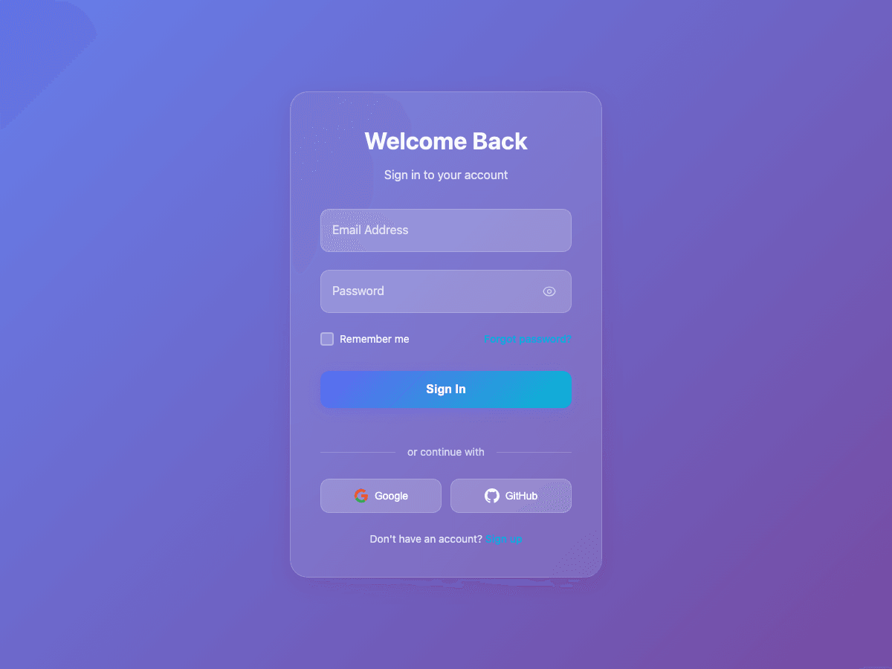
        </a>
        <br>
        <b>Glassmorphism</b><br>
        <sub>Frosted glass effects</sub><br>
        <a href="https://puikinsh.github.io/login-forms/forms/glassmorphism/">Live Demo</a> | <a href="forms/glassmorphism/">Source</a>
      </td>
      <td align="center" width="33%">
        <a href="https://puikinsh.github.io/login-forms/forms/neon/">
          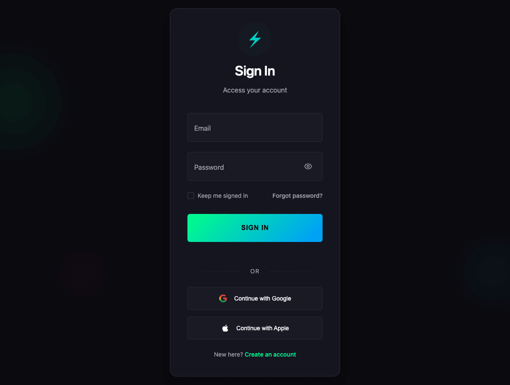
        </a>
        <br>
        <b>Neon Minimalist</b><br>
        <sub>Dark theme with neon</sub><br>
        <a href="https://puikinsh.github.io/login-forms/forms/neon/">Live Demo</a> | <a href="forms/neon/">Source</a>
      </td>
      <td align="center" width="33%">
        <a href="https://puikinsh.github.io/login-forms/forms/gradient-wave/">
          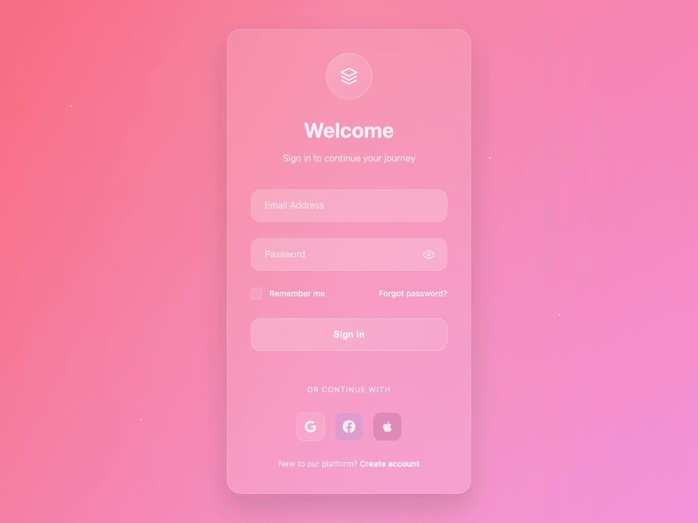
        </a>
        <br>
        <b>Gradient Wave</b><br>
        <sub>Animated gradients</sub><br>
        <a href="https://puikinsh.github.io/login-forms/forms/gradient-wave/">Live Demo</a> | <a href="forms/gradient-wave/">Source</a>
      </td>
    </tr>
    <tr>
      <td align="center">
        <a href="https://puikinsh.github.io/login-forms/forms/neumorphism/">
          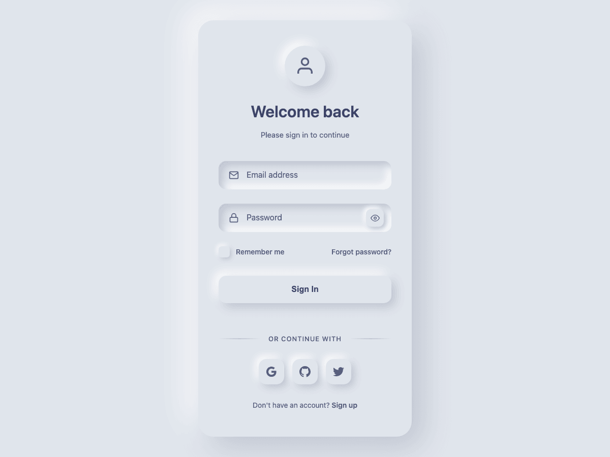
        </a>
        <br>
        <b>Neumorphism</b><br>
        <sub>Soft UI design</sub><br>
        <a href="https://puikinsh.github.io/login-forms/forms/neumorphism/">Live Demo</a> | <a href="forms/neumorphism/">Source</a>
      </td>
      <td align="center">
        <a href="https://puikinsh.github.io/login-forms/forms/corporate/">
          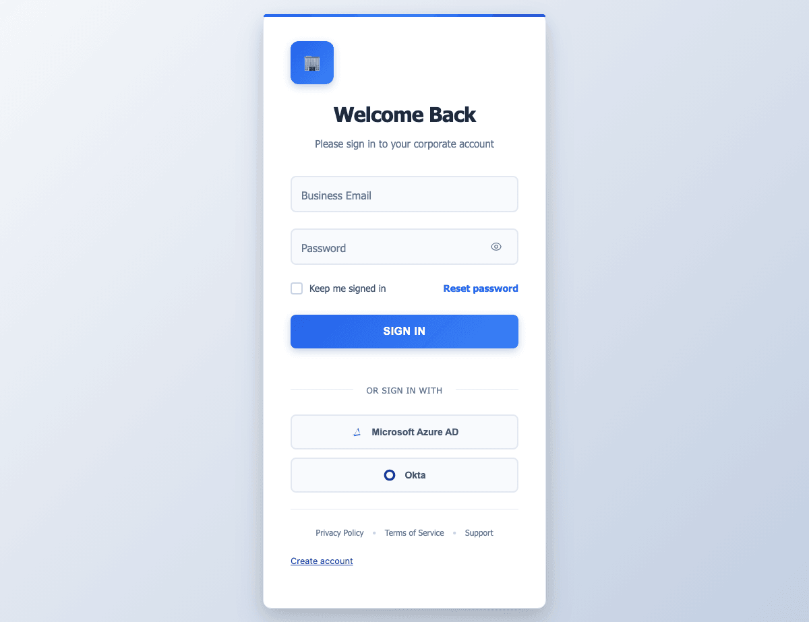
        </a>
        <br>
        <b>Corporate Professional</b><br>
        <sub>Enterprise-grade</sub><br>
        <a href="https://puikinsh.github.io/login-forms/forms/corporate/">Live Demo</a> | <a href="forms/corporate/">Source</a>
      </td>
      <td align="center">
        <a href="https://puikinsh.github.io/login-forms/forms/material/">
          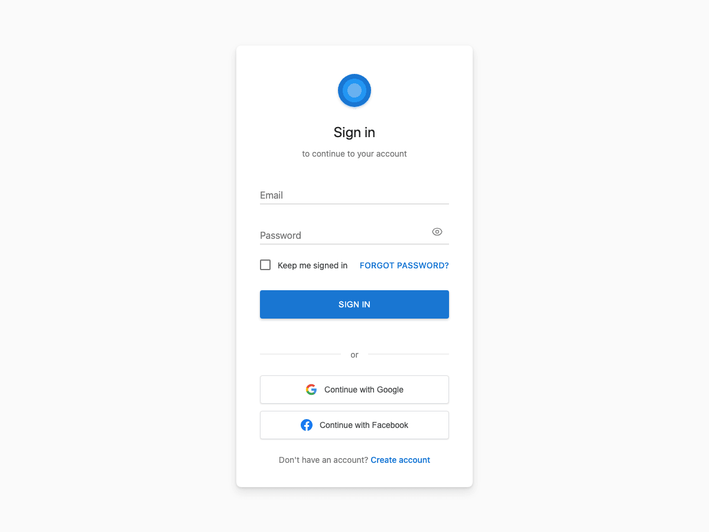
        </a>
        <br>
        <b>Material Design</b><br>
        <sub>Google's Material UI</sub><br>
        <a href="https://puikinsh.github.io/login-forms/forms/material/">Live Demo</a> | <a href="forms/material/">Source</a>
      </td>
    </tr>
    <tr>
      <td align="center">
        <a href="https://puikinsh.github.io/login-forms/forms/basic/">
          
        </a>
        <br>
        <b>Basic Form</b><br>
        <sub>Clean & simple</sub><br>
        <a href="https://puikinsh.github.io/login-forms/forms/basic/">Live Demo</a> | <a href="forms/basic/">Source</a>
      </td>
      <td align="center">
        <a href="https://puikinsh.github.io/login-forms/forms/minimal/">
          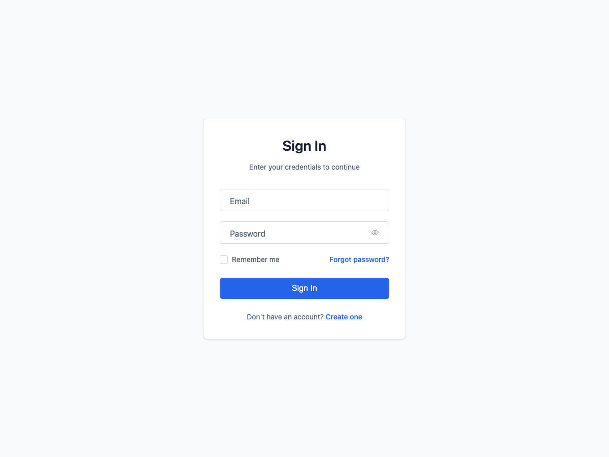
        </a>
        <br>
        <b>Minimal Clean</b><br>
        <sub>Ultra-minimal design</sub><br>
        <a href="https://puikinsh.github.io/login-forms/forms/minimal/">Live Demo</a> | <a href="forms/minimal/">Source</a>
      </td>
      <td align="center">
        <a href="https://puikinsh.github.io/login-forms/forms/creative/">
          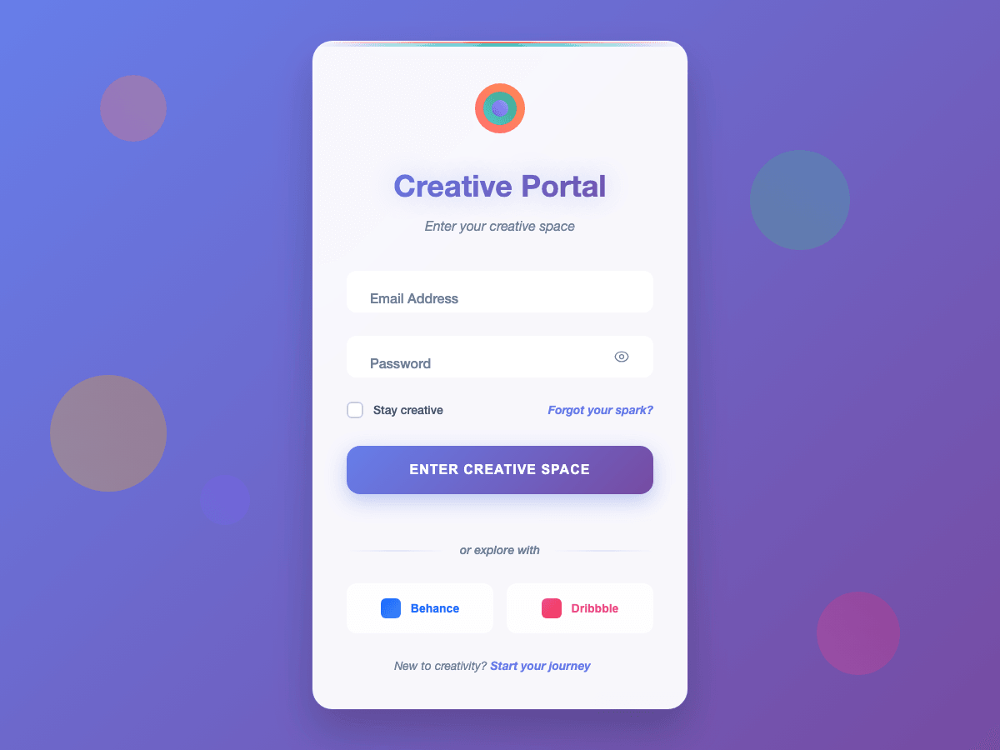
        </a>
        <br>
        <b>Creative Portal</b><br>
        <sub>Interactive animations</sub><br>
        <a href="https://puikinsh.github.io/login-forms/forms/creative/">Live Demo</a> | <a href="forms/creative/">Source</a>
      </td>
    </tr>
    <tr>
      <td align="center">
        <a href="https://puikinsh.github.io/login-forms/forms/eco-wellness/">
          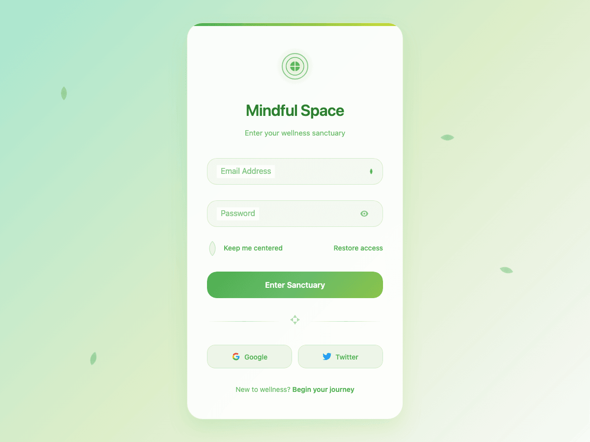
        </a>
        <br>
        <b>Eco Wellness</b><br>
        <sub>Nature-inspired</sub><br>
        <a href="https://puikinsh.github.io/login-forms/forms/eco-wellness/">Live Demo</a> | <a href="forms/eco-wellness/">Source</a>
      </td>
      <td align="center">
        <a href="https://puikinsh.github.io/login-forms/forms/ai-assistant/">
          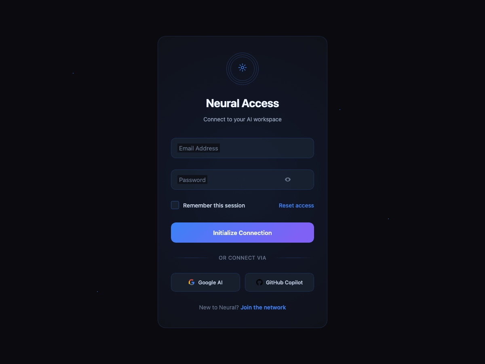
        </a>
        <br>
        <b>AI Assistant</b><br>
        <sub>Neural network theme</sub><br>
        <a href="https://puikinsh.github.io/login-forms/forms/ai-assistant/">Live Demo</a> | <a href="forms/ai-assistant/">Source</a>
      </td>
      <td align="center">
        <a href="https://puikinsh.github.io/login-forms/forms/neon-cyber/">
          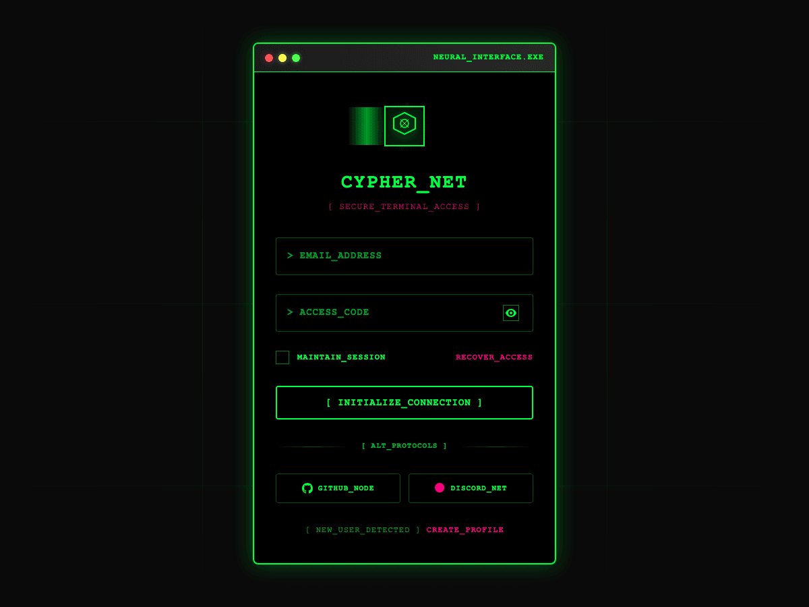
        </a>
        <br>
        <b>Neon Cyber</b><br>
        <sub>Cyberpunk aesthetic</sub><br>
        <a href="https://puikinsh.github.io/login-forms/forms/neon-cyber/">Live Demo</a> | <a href="forms/neon-cyber/">Source</a>
      </td>
    </tr>
    <tr>
      <td align="center">
        <a href="https://puikinsh.github.io/login-forms/forms/soft-minimalism/">
          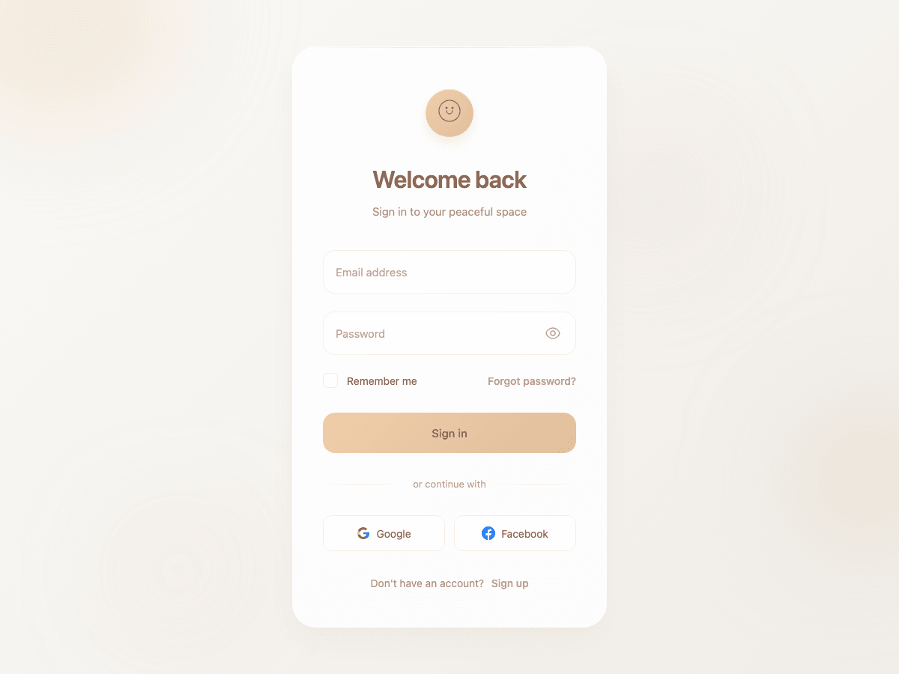
        </a>
        <br>
        <b>Soft Minimalism</b><br>
        <sub>Warm & organic</sub><br>
        <a href="https://puikinsh.github.io/login-forms/forms/soft-minimalism/">Live Demo</a> | <a href="forms/soft-minimalism/">Source</a>
      </td>
      <td align="center">
        <a href="https://puikinsh.github.io/login-forms/forms/retro-future/">
          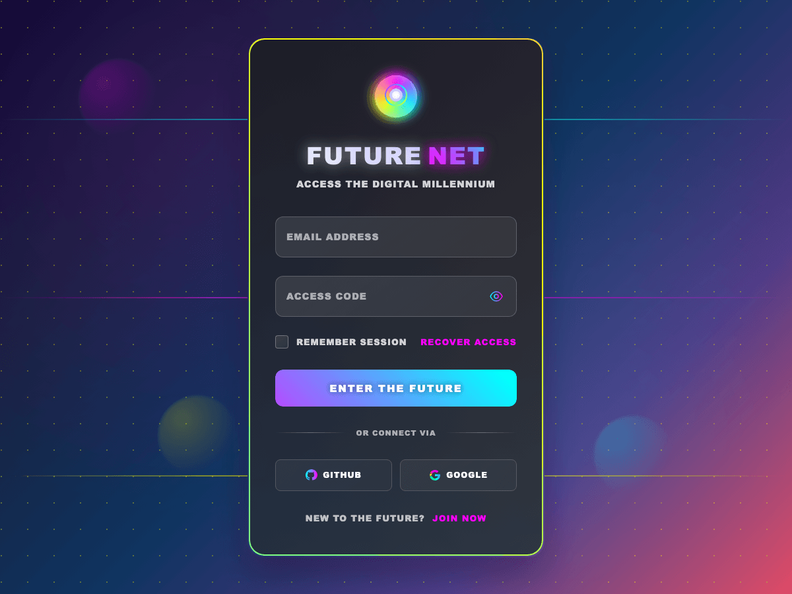
        </a>
        <br>
        <b>Retro Future</b><br>
        <sub>Y2K revival style</sub><br>
        <a href="https://puikinsh.github.io/login-forms/forms/retro-future/">Live Demo</a> | <a href="forms/retro-future/">Source</a>
      </td>
      <td align="center">
        <a href="https://puikinsh.github.io/login-forms/forms/minimal-music/">
          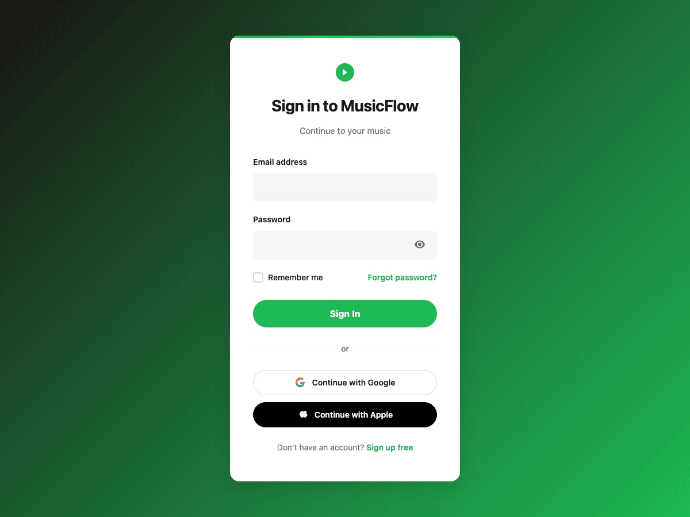
        </a>
        <br>
        <b>Minimal Music</b><br>
        <sub>Spotify-inspired</sub><br>
        <a href="https://puikinsh.github.io/login-forms/forms/minimal-music/">Live Demo</a> | <a href="forms/minimal-music/">Source</a>
      </td>
    </tr>
    <tr>
      <td align="center">
        <a href="https://puikinsh.github.io/login-forms/forms/travel-booking/">
          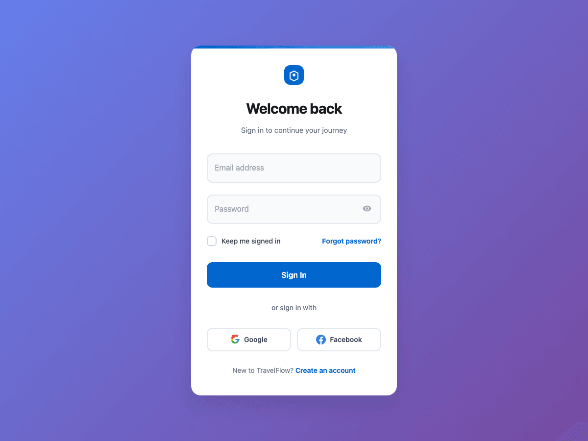
        </a>
        <br>
        <b>Travel Booking</b><br>
        <sub>Travel industry theme</sub><br>
        <a href="https://puikinsh.github.io/login-forms/forms/travel-booking/">Live Demo</a> | <a href="forms/travel-booking/">Source</a>
      </td>
      <td align="center">
        <a href="https://puikinsh.github.io/login-forms/forms/clean-banking/">
          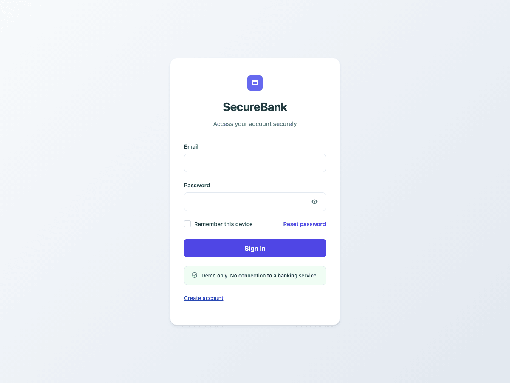
        </a>
        <br>
        <b>Clean Banking</b><br>
        <sub>Fintech design</sub><br>
        <a href="https://puikinsh.github.io/login-forms/forms/clean-banking/">Live Demo</a> | <a href="forms/clean-banking/">Source</a>
      </td>
      <td align="center">
        <a href="https://puikinsh.github.io/login-forms/forms/modern-saas/">
          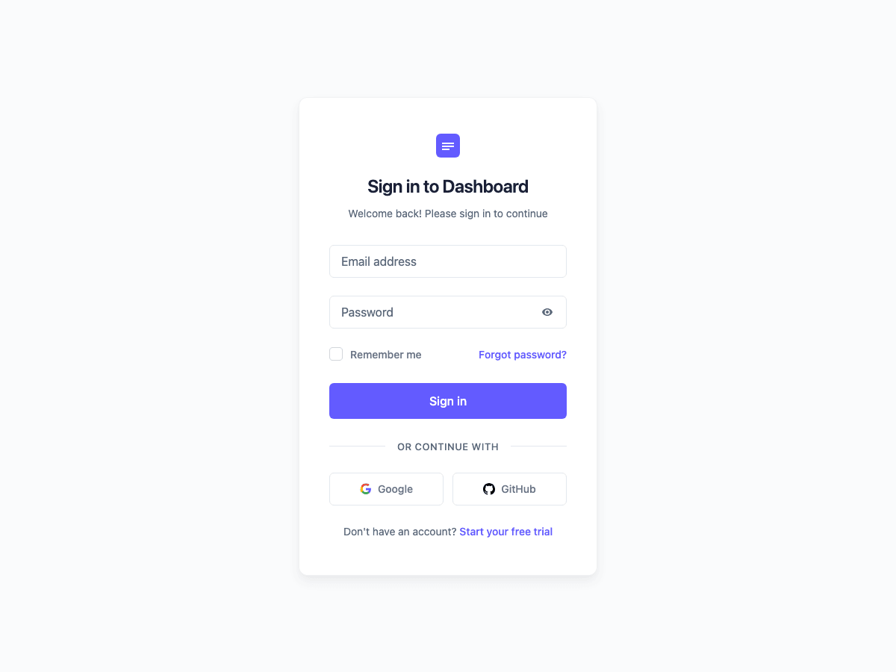
        </a>
        <br>
        <b>Modern SaaS</b><br>
        <sub>Stripe-inspired</sub><br>
        <a href="https://puikinsh.github.io/login-forms/forms/modern-saas/">Live Demo</a> | <a href="forms/modern-saas/">Source</a>
      </td>
    </tr>
    <tr>
      <td align="center">
        <a href="https://puikinsh.github.io/login-forms/forms/elegant-portfolio/">
          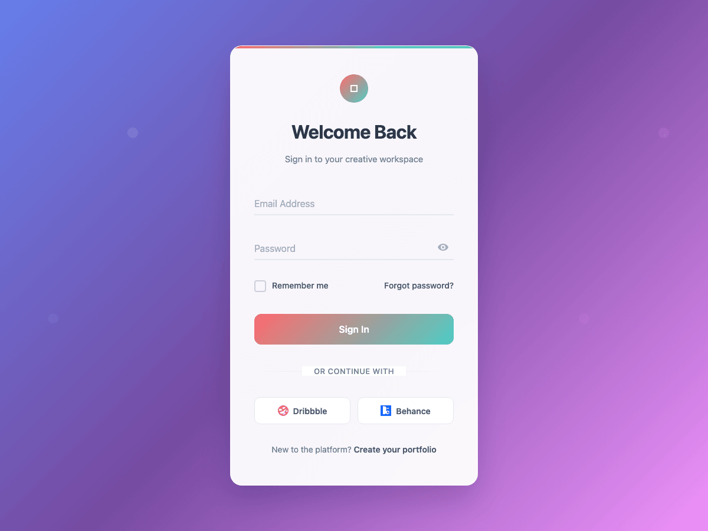
        </a>
        <br>
        <b>Elegant Portfolio</b><br>
        <sub>Creative professional</sub><br>
        <a href="https://puikinsh.github.io/login-forms/forms/elegant-portfolio/">Live Demo</a> | <a href="forms/elegant-portfolio/">Source</a>
      </td>
      <td align="center">
        <a href="https://puikinsh.github.io/login-forms/forms/brutalist/">
          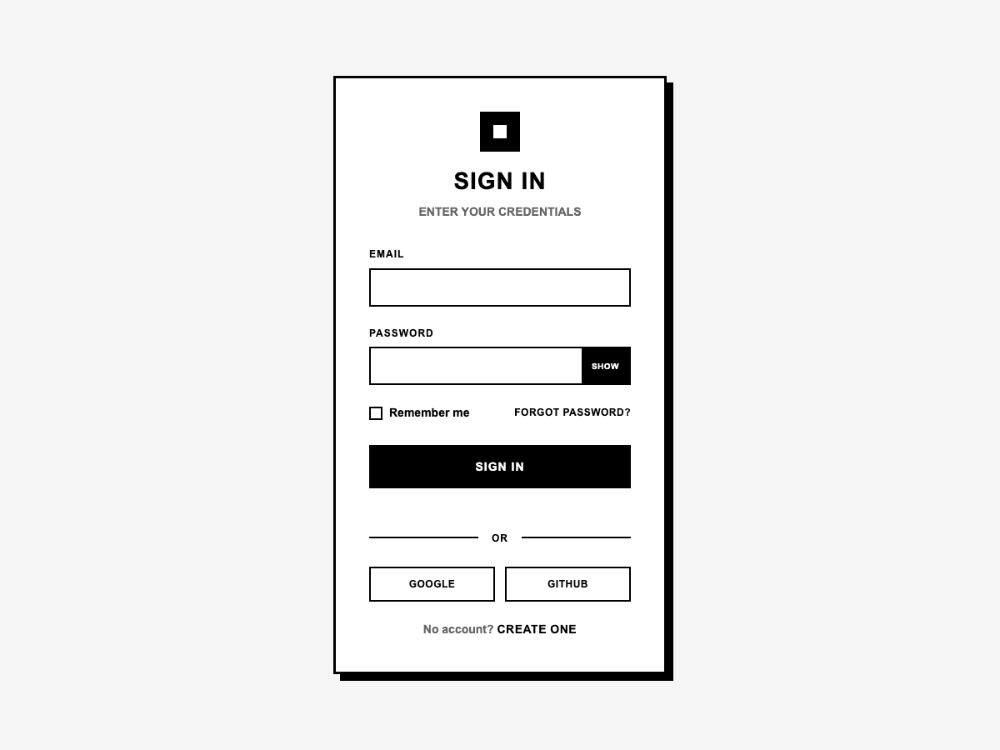
        </a>
        <br>
        <b>Brutalist</b><br>
        <sub>Bold & minimal</sub><br>
        <a href="https://puikinsh.github.io/login-forms/forms/brutalist/">Live Demo</a> | <a href="forms/brutalist/">Source</a>
      </td>
      <td align="center">
        <!-- Empty cell for grid alignment -->
      </td>
    </tr>
  </table>
</div>

### Design Studies — 20 additional directions

These original CSS/SVG compositions draw on editorial, architecture, music, art,
and retail references. See [research and composition notes](docs/design-research.md)
for the Framer/Dribbble references and design decisions. Every design includes all
four account screens, live previews/comparisons, favorites, and a standalone ZIP.

| Design | Preview | Composition |
| --- | --- | --- |
| [Folio Editorial](forms/folio-editorial/) | [Screenshot](assets/screenshots/folio-editorial.png) | Editorial membership portal with a narrow ink rail, oversized serif type, and a numbered issue stamp. |
| [Swiss Grid](forms/swiss-grid/) | [Screenshot](assets/screenshots/swiss-grid.png) | A vermilion Swiss poster, strict numbered rules, compressed headlines, and an open form column. |
| [Architecture Blueprint](forms/architect-blueprint/) | [Screenshot](assets/screenshots/architect-blueprint.png) | Architectural drawing sheet with a measured cobalt grid, elevation lines, and a technical sidebar. |
| [Ceramic Studio](forms/ceramic-studio/) | [Screenshot](assets/screenshots/ceramic-studio.png) | An earthy ceramics studio with a sculptural vessel still life and quiet, rounded authentication fields. |
| [Film Darkroom](forms/film-darkroom/) | [Screenshot](assets/screenshots/film-darkroom.png) | A photographic darkroom with a perforated film strip, abstract exposures, amber contact-sheet labels, and a dark form. |
| [Botanical Index](forms/botanical-index/) | [Screenshot](assets/screenshots/botanical-index.png) | An olive specimen catalogue with oversized botanical linework, inventory labels, and an airy off-white form. |
| [Audio Console](forms/audio-console/) | [Screenshot](assets/screenshots/audio-console.png) | A mint-on-charcoal recording desk with stereo meters, physical faders, and a studio access panel. |
| [Museum Ticket](forms/museum-ticket/) | [Screenshot](assets/screenshots/museum-ticket.png) | A ticket-shaped access panel with a perforated seam, exhibition typography, and a large abstract exhibition print. |
| [Atelier Fashion](forms/atelier-fashion/) | [Screenshot](assets/screenshots/atelier-fashion.png) | A fashion house invitation with plum paper, expressive serif type, an abstract folded garment, and a spare cream form. |
| [Cobalt Orbit](forms/cobalt-orbit/) | [Screenshot](assets/screenshots/cobalt-orbit.png) | A cobalt orbital diagram wraps a circular brand field, paired with a crisp floating authentication panel. |
| [Terrace Travel](forms/terrace-travel/) | [Screenshot](assets/screenshots/terrace-travel.png) | A warm Mediterranean landscape with stepped terraces, an oversized sun, and a passport-like inset form. |
| [Terminal Cloud](forms/terminal-cloud/) | [Screenshot](assets/screenshots/terminal-cloud.png) | A developer workbench with a real-looking static command transcript, status dots, and a compact cloud access panel. |
| [Paper Notes](forms/paper-notes/) | [Screenshot](assets/screenshots/paper-notes.png) | A ruled paper desk with layered notes, a hand-drawn loop, and a lemon-yellow writing pad for the form. |
| [Racing Paddock](forms/racing-paddock/) | [Screenshot](assets/screenshots/racing-paddock.png) | Motorsport timing-board typography, an oversized racing number, a checkered finish band, and sharp edged controls. |
| [Bauhaus Workshop](forms/bauhaus-workshop/) | [Screenshot](assets/screenshots/bauhaus-workshop.png) | A primary-color workshop of geometric tiles with a freestanding form and deliberate asymmetry. |
| [Mono Journal](forms/mono-journal/) | [Screenshot](assets/screenshots/mono-journal.png) | A full-width newspaper masthead, oversized issue number, editorial columns, and a reader access form. |
| [Gallery Frame](forms/gallery-frame/) | [Screenshot](assets/screenshots/gallery-frame.png) | An art-gallery wall with a floating framed color study, exhibition captions, and a cool white access column. |
| [Terra Maps](forms/terra-maps/) | [Screenshot](assets/screenshots/terra-maps.png) | A field journal with contour-map linework, a waypoint marker, and a sand-colored inset expedition form. |
| [Citrus Market](forms/citrus-market/) | [Screenshot](assets/screenshots/citrus-market.png) | A neighborhood market with hand-cut citrus shapes, a green checkered tablecloth, and a receipt-style login. |
| [Kinetic Type](forms/kinetic-type/) | [Screenshot](assets/screenshots/kinetic-type.png) | A saturated pink type specimen with offset oversized letterforms, a red margin rail, and a compact off-white form. |

## 📂 Forms by Category

### Design Studies
- **[Folio Editorial](forms/folio-editorial/)** — Editorial membership portal with a narrow ink rail, oversized serif type, and a numbered issue stamp.
- **[Swiss Grid](forms/swiss-grid/)** — A vermilion Swiss poster, strict numbered rules, compressed headlines, and an open form column.
- **[Architecture Blueprint](forms/architect-blueprint/)** — Architectural drawing sheet with a measured cobalt grid, elevation lines, and a technical sidebar.
- **[Ceramic Studio](forms/ceramic-studio/)** — An earthy ceramics studio with a sculptural vessel still life and quiet, rounded authentication fields.
- **[Film Darkroom](forms/film-darkroom/)** — A photographic darkroom with a perforated film strip, abstract exposures, amber contact-sheet labels, and a dark form.
- **[Botanical Index](forms/botanical-index/)** — An olive specimen catalogue with oversized botanical linework, inventory labels, and an airy off-white form.
- **[Audio Console](forms/audio-console/)** — A mint-on-charcoal recording desk with stereo meters, physical faders, and a studio access panel.
- **[Museum Ticket](forms/museum-ticket/)** — A ticket-shaped access panel with a perforated seam, exhibition typography, and a large abstract exhibition print.
- **[Atelier Fashion](forms/atelier-fashion/)** — A fashion house invitation with plum paper, expressive serif type, an abstract folded garment, and a spare cream form.
- **[Cobalt Orbit](forms/cobalt-orbit/)** — A cobalt orbital diagram wraps a circular brand field, paired with a crisp floating authentication panel.
- **[Terrace Travel](forms/terrace-travel/)** — A warm Mediterranean landscape with stepped terraces, an oversized sun, and a passport-like inset form.
- **[Terminal Cloud](forms/terminal-cloud/)** — A developer workbench with a real-looking static command transcript, status dots, and a compact cloud access panel.
- **[Paper Notes](forms/paper-notes/)** — A ruled paper desk with layered notes, a hand-drawn loop, and a lemon-yellow writing pad for the form.
- **[Racing Paddock](forms/racing-paddock/)** — Motorsport timing-board typography, an oversized racing number, a checkered finish band, and sharp edged controls.
- **[Bauhaus Workshop](forms/bauhaus-workshop/)** — A primary-color workshop of geometric tiles with a freestanding form and deliberate asymmetry.
- **[Mono Journal](forms/mono-journal/)** — A full-width newspaper masthead, oversized issue number, editorial columns, and a reader access form.
- **[Gallery Frame](forms/gallery-frame/)** — An art-gallery wall with a floating framed color study, exhibition captions, and a cool white access column.
- **[Terra Maps](forms/terra-maps/)** — A field journal with contour-map linework, a waypoint marker, and a sand-colored inset expedition form.
- **[Citrus Market](forms/citrus-market/)** — A neighborhood market with hand-cut citrus shapes, a green checkered tablecloth, and a receipt-style login.
- **[Kinetic Type](forms/kinetic-type/)** — A saturated pink type specimen with offset oversized letterforms, a red margin rail, and a compact off-white form.

### 🎨 Modern & Stylish
- **[Glassmorphism](forms/glassmorphism/)** - Frosted glass effects with backdrop blur
- **[Neon Minimalist](forms/neon/)** - Dark theme with glowing neon accents
- **[Gradient Wave](forms/gradient-wave/)** - Dynamic gradient animations
- **[Neumorphism](forms/neumorphism/)** - Soft UI with realistic shadows

### 💼 Corporate & Clean  
- **[Corporate Professional](forms/corporate/)** - Enterprise-grade with SSO integration
- **[Material Design](forms/material/)** - Google's Material Design principles
- **[Clean Banking](forms/clean-banking/)** - Fintech-inspired professional design
- **[Modern SaaS](forms/modern-saas/)** - Stripe-inspired minimal design

### 🎯 Minimal & Simple
- **[Basic Form](forms/basic/)** - Simple, functional design for quick implementation
- **[Minimal Clean](forms/minimal/)** - Ultra-clean using system fonts
- **[Soft Minimalism](forms/soft-minimalism/)** - Warm minimalism with organic shapes
- **[Brutalist](forms/brutalist/)** - Bold, raw aesthetic

### 🎨 Creative & Artistic
- **[Creative Portal](forms/creative/)** - Interactive animations with floating shapes
- **[Retro Future](forms/retro-future/)** - Y2K revival with chrome effects
- **[Elegant Portfolio](forms/elegant-portfolio/)** - Dribbble-inspired creative design

### 🌟 Themed & Unique
- **[AI Assistant](forms/ai-assistant/)** - Neural network-inspired design
- **[Eco Wellness](forms/eco-wellness/)** - Nature-inspired with organic shapes
- **[Neon Cyber](forms/neon-cyber/)** - Cyberpunk gaming aesthetic
- **[Minimal Music](forms/minimal-music/)** - Spotify-inspired clean design
- **[Travel Booking](forms/travel-booking/)** - Travel industry themed

## 🛠️ Quick Start

### 1. Browse & Choose

Open `index.html` in your browser to see all forms in action with live previews.

### 2. Copy Form Files

Each form is self-contained in its own directory:
```
forms/[form-name]/
├── index.html    # Form HTML structure
├── style.css     # Complete styling
├── script.js     # Form functionality
└── README.md     # Documentation
```

### 3. Include the shared utilities

Copy `shared/js/form-utils.js` alongside your form folder. It provides:

- `FormUtils.LoginFormBase` — the form lifecycle base class every form extends
- `FormUtils.validateEmail` / `validatePassword` — drop-in validators
- `FormUtils.showNotification` — XSS-safe toast (uses `textContent`, not `innerHTML`)
- `FormUtils.setupFloatingLabels` / `setupPasswordToggle` — common UI helpers

### 4. Customize

- Modify colors and styling in `style.css`
- Adjust the base class options in `script.js` (form-group selector, validators, elements to hide on success, etc.) — see any per-form `script.js` for examples (most are 30–80 lines)
- Update text and labels in `index.html`

### Demo credentials

The included `simulateLogin` always succeeds **except** for one specific combination, used to demonstrate error states:

- email: `admin@demo.com`
- password: `wrongpassword`

## 📁 Project Structure

```
login-forms/
├── index.html                  # Main showcase page (gallery)
├── CHANGELOG.md                # Project history
├── shared/
│   └── js/
│       └── form-utils.js      # FormUtils helpers + LoginFormBase class
├── forms/                     # 40 self-contained form templates
│   ├── glassmorphism/
│   ├── neon/
│   ├── minimal/
│   └── ... (40 forms total)
├── assets/
│   └── screenshots/           # Responsive WebP previews + PNG fallbacks
└── docs/
    ├── design-guide.md
    └── screenshot-integration-guide.md
```

## 🎯 Form Features

Each form includes:

- ✅ Email and password inputs with validation
- ✅ Design-specific labels, including floating-label variants
- ✅ Password visibility toggle
- ✅ Real-time validation feedback
- ✅ Loading and success states
- ✅ Responsive mobile-first design
- ✅ ARIA labels on icon controls + visible keyboard focus rings
- ✅ Honors `prefers-reduced-motion`
- ✅ Meta description, Open Graph image, Twitter card, and SVG favicon
- ✅ Remember me checkbox, forgot password and sign up links

## 🏛 Architecture

Every form is backed by `FormUtils.LoginFormBase` (in `shared/js/form-utils.js`). The base class owns the lifecycle:

```js
class GlassmorphismLoginForm extends FormUtils.LoginFormBase {
    constructor() {
        super({
            hideOnSuccess: ['.divider', '.social-login', '.signup-link'],
            // optional: validators, formGroupSelector, cardSelector,
            // submitButtonSelector
        });
    }

    decorate() {
        // form-specific entrance animations or visual flourishes go here
    }
}
```

What the base class handles for you:

- form submit, validation, and field-level error display
- floating labels, password toggle, success state and focus management
- forgot-password, sign-up, and social-login link defaults
- form-scoped keyboard shortcuts (no document-level leaks)
- shake/animation cleanup via `animationend` (no `setTimeout` races)

What you override per form:

- `decorate()` for entrance effects, particles, parallax, glitch, etc.
- `onSuccess()` if your form needs a custom success transition
- constructor options for selectors and validators that differ from the defaults

Per-design scripts configure the shared base class and visual hooks. New design studies use small constructors; older designs retain their distinct animation hooks.

## 🎨 Customization Guide

### Colors & Theming
Each form uses CSS variables or inline styles that can be easily modified:
- Primary colors
- Background gradients
- Text colors
- Border styles

### Form Validation
Validation rules in `shared/js/form-utils.js`:
- Email format validation
- Existing sign-in passwords: required, passed unchanged
- Signup/new passwords: at least 15 characters, with spaces and paste supported
- Custom error messages
- Success confirmations

### Animations
- Entrance animations
- Hover effects
- Focus transitions
- Success celebrations

## 🔧 Technical Details

### Browser verification

Automated checks use the Chromium, Firefox, and WebKit engines pinned by the
Playwright development dependency. Desktop/mobile visual checks use Chromium.
These checks verify the current engines, not a promise that every older browser
supports the enhanced gallery. Without gallery JavaScript or native dialog
support, direct demo and ZIP links remain available.

### Performance

- No external runtime dependencies — no CDN, no Google Fonts, no npm
- Responsive 400/800px WebP gallery thumbnails, lazy loaded with PNG fallbacks; all 400px thumbnails total under 200 KiB
- Lazy-loading on gallery images
- Small per-design subclasses across all 40 forms; validation and authentication lifecycle stay shared

### Accessibility

- Visible keyboard focus rings via `:focus-visible` (mouse users unaffected)
- Honors `prefers-reduced-motion: reduce` globally — animations collapse to ~0ms
- Semantic HTML, ARIA labels on icon-only controls, `role="alert"` / `role="status"` on toasts
- Form-scoped keyboard handlers (no document-level listener leaks)
- All inputs have `autocomplete` hints (`email`, `current-password`)

### Security

- `FormUtils.showNotification` uses `textContent` instead of `innerHTML` — error messages from the auth backend cannot inject HTML
- No `eval`, no `new Function`, no inline event handlers anywhere

## 🤝 Contributing

We welcome contributions! Feel free to:
- Submit bug reports and feature requests
- Create new form designs following our guidelines
- Improve existing forms and documentation
- Share your customizations and use cases

## 📝 License

This project is created by [Aigars Silkalns](https://github.com/puikinsh) for [Colorlib](https://colorlib.com).

## 📜 Changelog

See [CHANGELOG.md](CHANGELOG.md) for the 2.1.0 release: 40 designs, 160 account screens, gallery comparisons, saved collections, complete downloads, and automated checks. The earlier 2.0 refactor introduced the shared base class.

## 📞 Support & Resources

- 🌐 Visit [Colorlib](https://colorlib.com) for more web design resources
- 📋 Browse [Login Forms Collection](https://colorlib.com/wp/cat/login-forms/)
- 🎨 Explore [HTML5 & CSS3 Login Forms](https://colorlib.com/wp/html5-and-css3-login-forms/)
- 💻 Check out [Aigars Silkalns' GitHub](https://github.com/puikinsh/) for other projects
- 🐛 Open an issue in this repository for bug reports

---

**Built with ❤️ by [Aigars Silkalns](https://github.com/puikinsh/) for [Colorlib](https://colorlib.com)**
See the [design/integration guide](docs/design-guide.md), [publishing checklist](docs/publishing.md), and [design research](docs/design-research.md).

## Development and quality checks

The forms still run directly from static files, without npm, a build step, CDN scripts, or runtime packages. The following tools are **only for contributors** (Node.js 24.8+):

```sh
npm ci
npx playwright install chromium firefox webkit
npm run check
npm test
```

`npm run check` validates JavaScript syntax, HTML structure, local links/assets, the shared form contract, gallery entries, and download freshness. Python 3.9+ is required only for package generation/checks and extraction tests; no additional Python packages are needed. `npm test` exercises every template in Chromium, Firefox, and WebKit: keyboard controls, all-field validation, loading, failure/retry, successful sign-in, sign-up and both reset steps, auxiliary actions, no-JavaScript fallback, mobile overflow, and axe accessibility scans. Geometry checks cover every screen at 1200, 640, 375, and 320px widths, including filled invalid fields, long wrapped errors, and revealed passwords. `npm run test:chromium` runs a focused browser pass. GitHub Actions runs the same checks on pushes and pull requests. Browser and visual projects run as separate jobs after static checks, each installing only its required engine and retaining its own HTML report. The gallery tests cover locally saved favorites, shared-list isolation and saving, blocked storage/clipboard fallbacks, complete selector inventories, cross-tab updates, combined filtering, empty results, desktop/mobile screen switching, complete reset navigation, keyboard/focus behavior, no-JavaScript browsing, accessibility, and downloading/extracting every package before signing in directly from its files. Run `npm run test:gallery` for these tests only. Use `npm run test:report` to inspect local failures and traces. Preview with `npm run preview` or the Python static server.

Keep testing changes in CI before merging. For visual changes, also review desktop/mobile layouts, zoom, contrast over animated backgrounds, actual password-manager autofill, and screen-reader announcements. Automated scans cannot establish full WCAG compliance.

### Matching sign-up and password reset

Every design includes `sign-up.html`, `reset-password.html` (request instructions),
and `new-password.html` (preview the final reset step). Existing sign-in links open
these pages. All four pages share the same themed stylesheet, script, and shared
helper, and work offline in the ZIP downloads.

The companion screens explicitly create no accounts, send no email, change no
passwords, and save nothing. Do not enter real credentials. A valid submission
shows a focused demo result after a short simulated wait. Reset requests always
use the same conditional response and provide a link to preview the new-password
screen. Use `error@demo.com` on sign-up/reset requests or `demo-error-password`
on the new-password screen to preview a temporary failure, then edit and retry.
No credentials travel through navigation URLs or browser storage.

New passwords require at least 15 Unicode code points, with no character-mix rule,
trimming, or paste restrictions. Hints and errors are associated with their fields;
submission focuses the first invalid field and reports all errors. Sign-in keeps
accepting existing passwords unchanged. The companion submit buttons remain
disabled without JavaScript and display an explanation; navigation still works.

Supply separate asynchronous `createAccount(email, password, data)`,
`requestReset(email, password, data)`, and `resetPassword(email, password, data)`
callbacks in `super({...})` to replace these simulations. They follow the same
resolve/reject convention as `authenticate` below. The reset callback must obtain
and verify a real token on the server; the preview page intentionally provides no
authentication or reset authorization. Replace demo notices, button labels, and
success copy when integrating your service. Your backend must enforce validation,
password policy, generic reset responses, expiring single-use tokens, and rate limits.

### Shared interaction contract

- Sign-in requires a valid email and a nonempty password. Passwords are passed unchanged; creation-time length/complexity policy belongs in registration and the backend.
- Credential errors are associated using `aria-describedby`; invalid fields set `aria-invalid`. Submission reports every invalid field and focuses the first.
- Native checkboxes remain in the keyboard tab order. The password toggle exposes `aria-pressed` and retains focus.
- `[data-action="forgot-password"]`, `[data-action="signup"]`, and `[data-action="social"][data-provider]` identify behavior regardless of visual class names. Sign-up and reset hooks follow real local page links; provider buttons show demo feedback.
- The submit button disables only while submitting or after success. Loading is announced, failed requests remain visible and allow retry, and success moves focus to the result.

### Connecting authentication

Pass an asynchronous `authenticate(email, password, data)` callback in a template's `super({...})` options. Resolve only after successful authentication; reject with a safe user-facing error on failure. `data` includes named form values, such as the optional remember checkbox. The demo callback remains the default. Never put service secrets in frontend files.

```js
super({
    authenticate: async (email, password, data) => {
        const response = await fetch('/api/login', {
            method: 'POST',
            headers: { 'Content-Type': 'application/json' },
            body: JSON.stringify({ email, password, remember: data.remember === 'on' }),
        });
        if (!response.ok) throw new Error('Unable to sign in. Please try again.');
    },
});
```

Your server owns credential verification, session security, CSRF defenses appropriate to your architecture, and rate limits. Forms require `shared/js/form-utils.js` at the referenced relative path when copied into another project.

### Updating downloads

Run `npm run package:forms` after changing a template or `shared/js/form-utils.js`, and commit the updated `downloads/*.zip` files. The Python standard-library generator includes only the eight runtime/instruction files, rewrites the shared script reference for standalone use, and fixes ZIP timestamps. CI compares archive contents with current source, allowing different Python/zlib versions while catching missing or stale packages. Static hosting serves the committed ZIPs directly; there is no runtime packaging service or client ZIP library.

### Screenshots and visual regression

Run `npm run screenshots` to refresh all gallery images from the current forms. The gallery uses responsive 400/800px WebP thumbnails; refreshed PNGs remain available for README/social previews. Image tooling stays development-only, and source/image manifests catch stale captures.

`npm run test:visual` compares desktop and mobile layouts for all forms (including validation errors), the complete gallery, and the live preview. It renders a frozen source reference alongside current code in the same browser to avoid OS/font differences. Inspect expected/actual/diff images with `npm run test:report`. After reviewing an intentional change, `npm run visual:update` explicitly accepts a new reference; CI never does this automatically. See [the screenshot workflow](docs/screenshot-integration-guide.md) for setup, budgets, and the review/update process.
