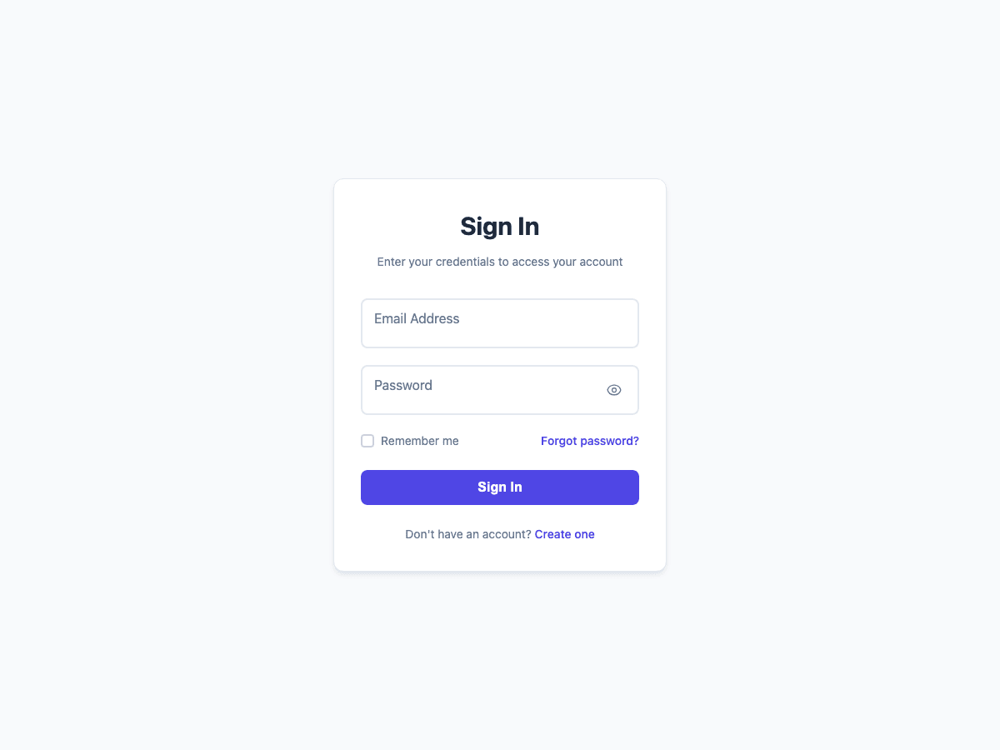

# Basic Login Form



A clean, simple, and functional login form that follows modern web standards. Perfect for quick implementation or as a starting point for customization.

## ✨ Features

- **Clean Design** - Minimal and professional appearance
- **Floating Labels** - Smooth label animations for better UX
- **Password Toggle** - Show/hide password functionality
- **Form Validation** - Real-time email and password validation
- **Loading States** - Visual feedback during submission
- **Success Animation** - Confirmation when login succeeds
- **Responsive Design** - Works perfectly on all devices
- **Accessibility** - ARIA labels and keyboard navigation
- **No Dependencies** - Pure HTML, CSS, and JavaScript

## 🎨 Design Features

- System font stack for native feel
- Subtle shadows and borders
- Clean color palette (#6366f1 primary)
- Smooth transitions and micro-interactions
- Mobile-first responsive design

## 📱 Browser Support

- Chrome 88+
- Firefox 103+
- Safari 15.4+
- Edge 88+

## 🔧 Technical Details

### Files Structure
```
basic/
├── index.html          # Main form structure
├── style.css           # Complete styling
├── script.js           # Form functionality
└── README.md           # This documentation
```

### Dependencies
- `../../shared/js/form-utils.js` - Shared validation and utilities

## 🚀 Usage

### Quick Start
1. Copy the entire `basic/` folder to your project
2. Copy `shared/js/form-utils.js` for full functionality
3. Open `index.html` in your browser or serve via HTTP

### Integration
```html
<!-- Include in your HTML -->
<link rel="stylesheet" href="path/to/basic/style.css">
<script src="path/to/shared/js/form-utils.js"></script>
<script src="path/to/basic/script.js"></script>
```

## ⚙️ Customization

### Colors
Modify the main colors in `style.css`:
```css
/* Primary color (buttons, links, focus states) */
#6366f1 → Your brand color

/* Background colors */
#f8fafc → Your background
white → Your card background

/* Text colors */
#1e293b → Your primary text
#64748b → Your secondary text
```

### Typography
The form uses system fonts by default. To use custom fonts:
```css
body {
    font-family: 'Your Font', -apple-system, BlinkMacSystemFont, ...;
}
```

### Form Behavior
Customize validation and submission in `script.js`:
```javascript
// Modify validation rules
FormUtils.validateEmail(value)
FormUtils.validatePassword(value)

// Customize login simulation
FormUtils.simulateLogin(email, password)
```

## 🎯 Form Fields

### Email Validation
- Required field
- Valid email format check
- Real-time validation feedback

### Password Requirements
- Required; existing passwords are accepted without length or composition rules
- Toggle visibility with eye icon

### Additional Features
- Remember me checkbox
- Forgot password link
- Account creation link

## 📋 Demo Credentials

For testing the demo functionality:
- **Successful login**: Any valid email + any password meeting requirements
- **Failed login**: `admin@demo.com` + `wrongpassword`

## 🔒 Security Notes

This is a frontend demo form. For production use:
- Implement proper backend authentication
- Use HTTPS for all login forms
- Add CSRF protection
- Implement rate limiting
- Use secure session management

## 📄 License

Part of the Modern Login Forms collection by [Aigars Silkalns](https://github.com/puikinsh/) for [Colorlib](https://colorlib.com).
## Shared behavior and checks

This template uses the shared sign-in behavior: a valid email and a nonempty, unchanged password; keyboard-accessible remember and password controls; associated field errors; and loading/failure/success feedback. Social actions show demo feedback. Sign-up and reset links open matching companion screens. See the root [development and integration guide](../../README.md#development-and-quality-checks) for automated checks and the `authenticate` callback.


## Matching sign-up and reset screens

Open `sign-up.html` to preview account creation, `reset-password.html` to request
reset instructions, or `new-password.html` to preview setting a new password.
These screens reuse this design's CSS and JavaScript. New passwords require at
least 15 characters; spaces and paste are allowed. Sign-in passwords remain unchanged.
All fields have associated validation messages, keyboard controls, loading feedback,
retryable errors, and a focused success result.

These are local demonstrations: no accounts are created, emails sent, passwords
changed, or data saved. Use `error@demo.com` for a sign-up/reset request failure or
`demo-error-password` for a new-password failure. Edit and retry to complete the demo.
Without JavaScript, navigation works and companion submission stays disabled.

For backend integration, see the root [companion-screen guide](../../README.md#matching-sign-up-and-password-reset).
The standalone download includes all four HTML screens and the shared helper.

Validation messages wrap below their controls. Filled labels remain separate from
typed values, including invalid fields, and password visibility preserves control
position and credential case. Tall pages remain vertically scrollable.
